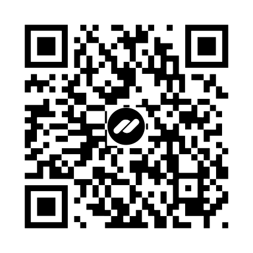

# Important Mail Alert for Mozilla Thunderbird

> **Stop losing orders and critical emails in the noise. Persistent, non-dismissing alerts for your dedicated priority mailboxes in Mozilla Thunderbird.**

Standard Thunderbird notifications disappear automatically after 5 seconds and often get lost in the system tray. This extension creates a persistent, non-dismissing popup alert above the taskbar when a new email arrives in your selected important mailboxes. It stays on screen until you interact with it!

---

# ✨ Features

- **Critical Mailbox Focus**  
  Triggers non-dismissing, sticky alerts *only* for your selected priority inboxes (e.g., website orders or VIP clients) out of dozens of connected accounts.

- **Instant Action & Navigation**  
  One-click "Open email →" button brings Thunderbird to focus and immediately opens the message, automatically closing the alert.

- **Native Look & Palette Tints**  
  Seamlessly matches Thunderbird's 4px desktop style with full Light/Dark theme support, 10 color tints, and an instant live preview.

- **Global & Customizable**  
  Includes optional custom audio alerts and native interface support for 8 languages (EN, RU, DE, ES, FR, IT, JA, PT).

---

## 📥 Installation

1. Download the latest source code or `.zip` archive from the [Releases](../../releases) section.
2. Open **Mozilla Thunderbird**.
3. Press `Ctrl + Shift + A` (or go to **Tools** → **Add-ons and Themes**).
4. Click the gear icon ⚙️ in the top right corner and choose **"Install Add-on From File..."** (or enable Debugging mode and load as temporary add-on).
5. Open the extension Options to pick your priority accounts and colors.

---

## ☕ Support the Author / Поддержать автора

If this extension saves your time and helps your workflow, you can buy me a coffee:

Если вам помог этот плагин, поддержите автора любым удобным способом:

<table>
  <tr>
    <td align="center" valign="top" width="160">
      <!-- Кастомный стикер для NOWPayments -->
      
       <b>Crypto via <a href="https://nowpayments.io/donation/thanksforthecoffee?p=important-mail-alert">NOWPayments<a></b>
    </td>
    <td valign="middle">
      • <b>В рублях (Карты РФ / СБП):</b> <a href="https://pay.cloudtips.ru/p/25bd5052">Поддержать через CloudTips</a> 
      

        
QR-code CloudTips

        
      

      • <b>Telegram / GRAM:</b> <a href="https://tonhub.com/transfer/UQDnGXbwiSak1mssK501iLCM1ZFPc87Kf-YtJ1OGgoupt64l">Оплатить в 1 клик</a> (или через ID: <code>UQDnGXbwiSak1mssK501iLCM1ZFPc87Kf-YtJ1OGgoupt64l</code>) 
      • <b>Binance Pay:</b> UID: <code>270361746</code>
      

        
QR-code Binance Pay

        
      

    </td>
  </tr>
</table>

---

## Краткое описание

Кастомный плагин под Mozilla Thunderbird (Manifest V3), решающий проблему исчезающих 5-секундных стандартных оповещений:
- Создает постоянное всплывающее окно в правом нижнем углу над треем.
- Кнопка «Открыть письмо →» моментально открывает сообщение в Thunderbird.
- Автоматически адаптирует оттенок под тёмную или светлую тему системы.
- Удобный выбор ящиков для отслеживания галочками в настройках.
